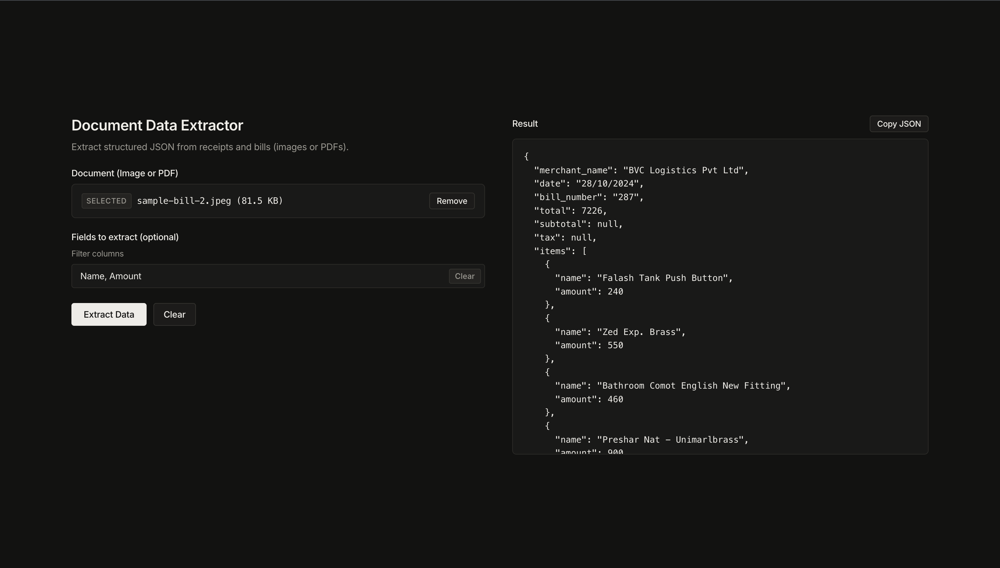

# Bill Extractor Middleware

Drop any receipt, invoice, or complex and messy handwritten slip — get structured JSON back with exceptional accuracy where traditional OCR fails. No parsers, no templates, no hardcoded schemas. Built on Gemini Vision with automatic model fallback and real-time payload compression designed to run 100% free.

## Preview

<div align="center">
  
</div>

## Tech Stack

- Node.js
- Express
- Google Gemini API
- Multer
- Sharp (image optimisation)
- HTML / JavaScript

## How It Works

- The Express server exposes a `POST /extract` endpoint that accepts documents through multipart form uploads (`file`) or base64 payloads (`file_base64`).
- Callers can optionally pass a comma-separated list of `fields` to extract only the values they need.
- Before sending to Gemini, images are automatically resized (max 1600 px) and compressed to JPEG 82% quality using `sharp` to reduce token usage and stay within free quota. PDFs are passed through unchanged.
- The server builds a prompt instructing Gemini to categorize row-level data (such as item name, price, quantity, and line total) inside an `items` array and document-wide values (such as merchant name and total) as top-level keys.
- The file and prompt are sent to Gemini with automatic model fallback: if the primary model hits its rate limit (429) or is unavailable (503), the service silently retries with the next cheapest model in the chain.

### Model Fallback Chain

| Priority | Model                   | Why                          |
| -------- | ----------------------- | ---------------------------- |
| #1       | `gemini-3.5-flash-lite` | Highest free quota, cheapest |
| #2       | `gemini-2.5-flash-lite` | Cheap lite fallback          |
| #3       | `gemini-2.5-flash`      | Mid-tier fallback            |
| #4       | `gemini-1.5-flash`      | Older but stable last resort |

## Getting Started

### 1. Clone & Install

```bash
git clone <repo-url>
cd <repo-name>
npm install
```

### 2. Configure Environment

```bash
cp .env.example .env
```

Open `.env` and add your Gemini API key (get one free from [Google AI Studio](https://aistudio.google.com/)):

```env
PORT=3000
GEMINI_API_KEY=your_gemini_api_key_here
```

### 3. Run

```bash
npm start
```

Open **`http://localhost:3000`** in your browser to test directly with sample receipts or your own documents.
